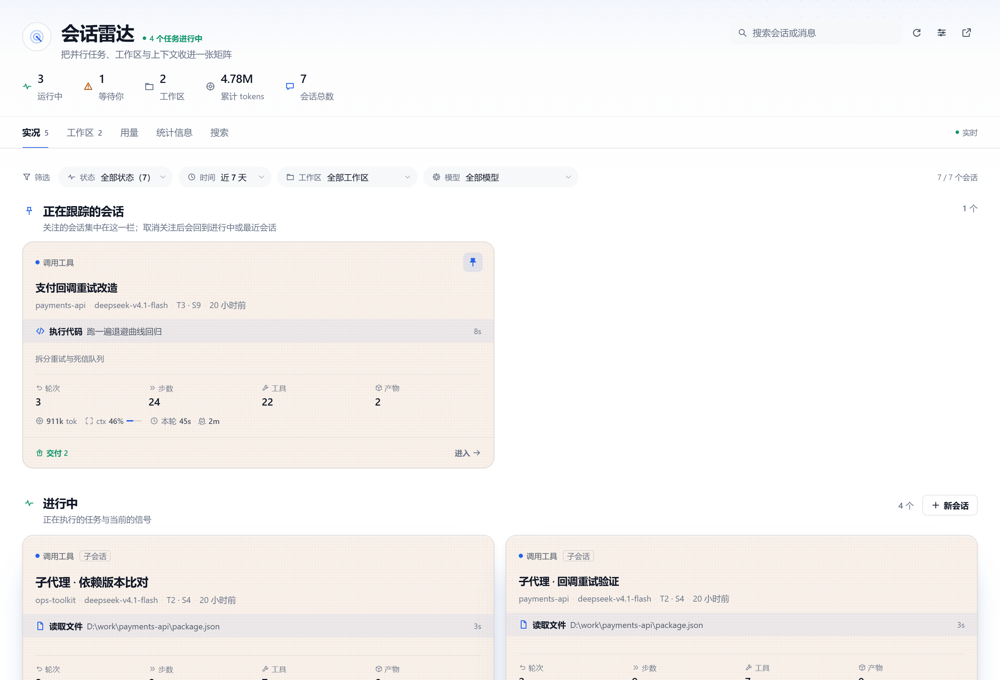
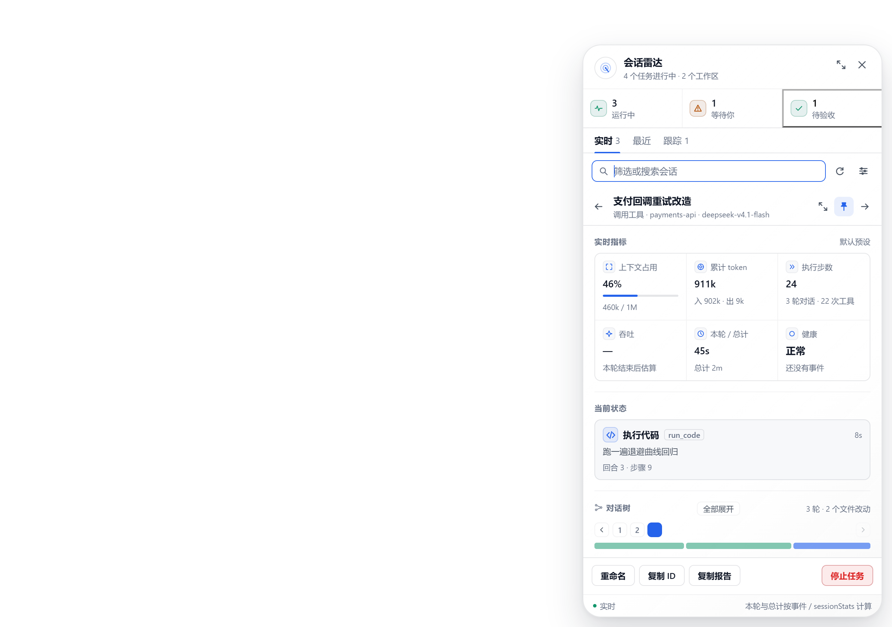
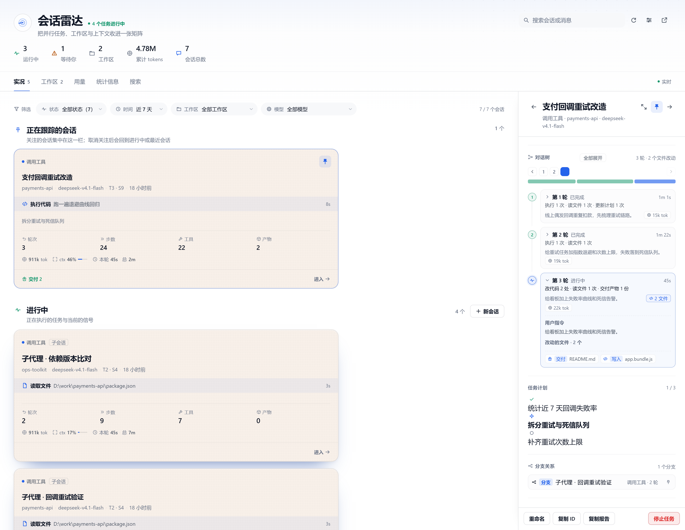
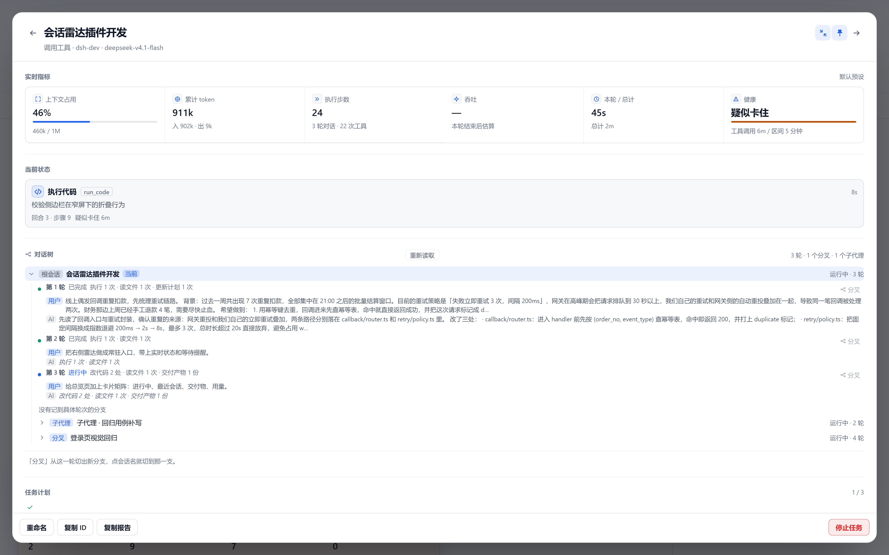
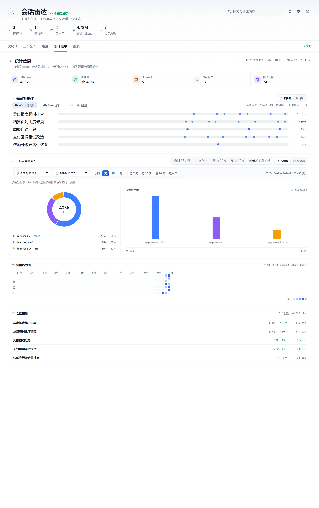
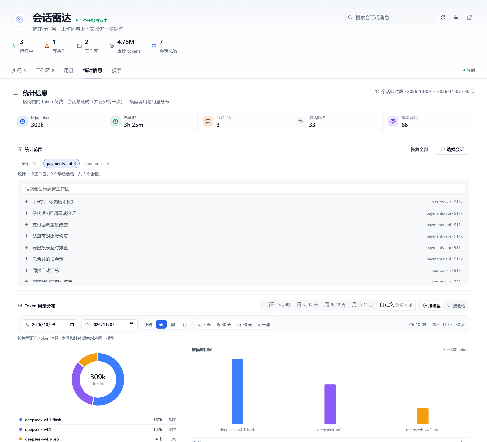
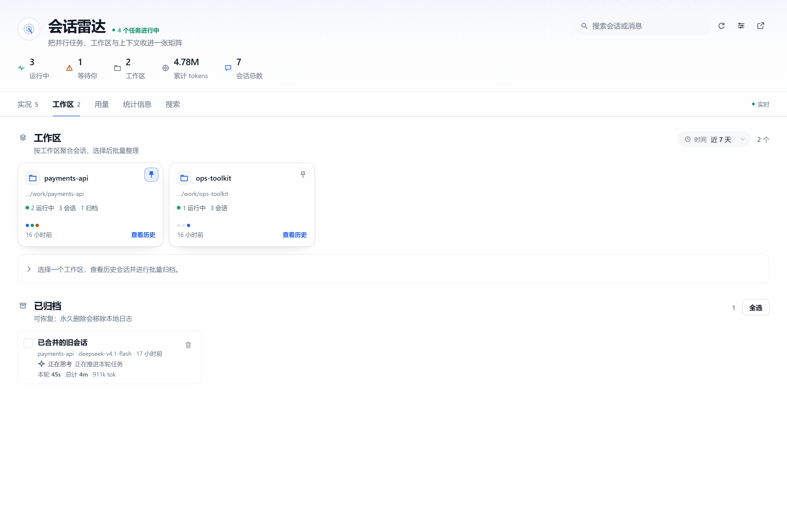

# dsh-session-radar

[中文](#中文) · [English](#english)

把并行会话收进一条常驻雷达：实时状态、当前步骤、等待时长、卡住告警、token 与上下文；点进会话能展开对话树，逐轮看清这一轮 AI 干了什么、改了哪些文件，还能切到全屏、跳到任意一轮、顺着分支在父子会话之间走动；统计信息页的区间可以任意自定义，token 只统计区间内真正花掉的部分，还能只挑几个工作区或会话来看；时长按「并行只算一次」的总耗时计算。

## 中文

### 功能

- **右侧雷达与快捷栏**：右侧边缘常驻一枚雷达按钮，显示运行中与等待中的会话数；下方快捷栏自动收纳运行中、待验收和已钉住的会话与工作区，鼠标靠近即展开，点一下直达会话。
- **左侧工作区栏置顶**：正在运行、已固定以及你当前正在看的那个会话会顶到左侧工作区栏最上面，点标题即可收起或展开，收起时只留一行摘要；换到别的会话后，那个不再运行的会话会自己掉出去。它和右侧快捷栏一样能在设置里一键关掉。
- **实况矩阵**：进行中与最近会话以卡片矩阵展示，每张卡片带轮次 / 步数 / 工具 / 产物四格仪表、token 与上下文占用、本轮与总计耗时；支持按状态、时间、工作区、模型筛选，以及按最近活动 / 最耗时 / token 最多排序。
- **异常一眼看到**：等待审批或回答的会话标出「已等了多久」；一次工具调用跑过安全区间（默认 5 分钟，可在设置里自填 1–120 分钟）才会标为「疑似卡住」，长构建和大改动不再动不动就报警，运行时静默同样按这个区间判定。卡片还给出本轮 token 吞吐与最耗时间的工具。
- **对话树**：点进会话即成树，每轮只给一句摘要——这一轮改了几处代码、执行了几次、读了哪些文件、有没有失败；展开某轮可看用户指令、AI 交代的做法和本轮改动的文件清单。树顶有轮次轨道，点数字直接跳到那一轮，也可以用上一轮 / 下一轮逐个翻；一键全部展开，或把整棵树复制成 Markdown 报告。
- **全屏与分支**：详情默认贴在右侧栏，点右上角展开按钮可切到全屏（Esc 退出），长对话不再挤在一列里。子代理会话按父子关系串成分支列表，点一下就跳到父会话或任意分支，还能就地固定到快捷栏。
- **统计信息**：活跃度账本按当日 / 日 / 周 / 月聚合，区间可以任意自定义（起止日期 + 小时 / 天 / 周 / 月粒度）。token 花费只算区间内的花费——按每一轮实际发生的时间归属，跨天或跨出区间的轮次只计入落在区间内的部分，不拿会话总量凑数；统计范围也可以手动勾选，只统计某几个工作区或某几个会话，「工作区」页签每张卡片上的「统计」按钮会直接把该工作区带进来。时长默认按会话运行区间的并集计算，并行会话不重复计时，可随时切回累计口径；「会话时间耗时」面板默认折叠，需要时展开看每个会话的时间轨道；另有模型 / 会话用量分布与 GitHub 式使用热力图。
- **工作区与归档**：按工作区聚合历史会话，支持批量归档、批量恢复与永久删除（删除前二次确认）。

### 截图

### 安装

打开你实际使用的 DSH 实例，在 **插件 → + 添加插件** 中粘贴插件发布包地址：

~~~text
https://github.com/abelian2E47/dsh-session-radar/releases/latest/download/dsh-session-radar-1.1.0.tgz
~~~

安装完成后重启 DSH，或等插件配置热重载生效。打开 Web GUI 后：

1. 左侧导航出现「会话雷达」。
2. 右侧边缘出现竖向雷达入口；有运行中、待验收或钉住的会话时，入口下方出现快捷栏。
3. 用快捷键唤起或切换：

| 操作 | 快捷键 |
| --- | --- |
| 打开 / 关闭右侧雷达 | Ctrl+Alt+Shift+R |
| 在固定会话之间切换 | Alt+] / Alt+[ |
| 固定或取消固定当前会话 | Alt+P |
| 退出全屏会话详情 | Esc |

### License

MIT

---

## English

An always-on radar for your parallel DSH sessions: live status, current step, wait time, stall alerts, tokens and context. Open any session to unfold a per-round conversation tree that says in one line what that round did and which files it changed, switch it to full screen, jump straight to any round, and walk the branches between a session and the subagents it spawned. The statistics page takes an arbitrary date range, counts only the tokens actually spent inside it, can be narrowed to picked workspaces or sessions, and counts duration as wall-clock time instead of the sum of every session.

### Features

- **Right-edge radar and quick bar**: a pinned radar button plus a quick bar that keeps running, unread and pinned sessions and workspaces one click away.
- **Pinned to the top of the workspace column**: running and pinned sessions — plus whichever session you are reading right now, even if it is idle — sit above the workspace tree in the left column, with a header that collapses or expands the list and a one-line summary while collapsed. They drop out on their own once you switch away, and the whole strip can be switched off in the settings like the quick bar.
- **Live matrix**: running and recent sessions as a card matrix with turns / steps / tools / deliverables, token and context meters, and per-turn plus total duration; filter by status, time, workspace and model, or sort by recent activity, longest, or token count.
- **Signals that matter**: approval and answer waits report how long they have been pending, and a session is only flagged as stalled once a single tool call passes the safety window (five minutes by default, freely set between 1 and 120 minutes in the settings) — long builds and heavy edits stop raising false alarms, and silence while running is judged against the same window. Each card also shows the current token throughput and the most expensive tool.
- **Conversation tree**: one summarised line per round — how much code changed, how many commands ran, which files were read, where it failed — and expanding a round reveals the prompt, how the model said it went about it, and every file that round touched. A round rail jumps straight to any round (or steps through them), expand-all flattens the tree, and one click copies the whole tree as a Markdown report.
- **Full screen and branches**: the detail lives in the right column by default; the header toggle expands it to a full-screen panel (Esc to leave). Subagent sessions are listed as branches of the session that spawned them, so you can jump to the parent or any child and pin it in place.
- **Statistics**: the local activity ledger rolls up by day / week / month, the window can be any start and end date with hour / day / week / month grains. Token spend counts only what was spent inside that window: every round is attributed to the time it actually covered, so a round that crosses midnight — or runs past the edge of the window — contributes just the part that happened inside it instead of the session's lifetime total. The scope can be narrowed by hand to a few workspaces or sessions, and the "stats" button on every workspace card hands that workspace straight over. Duration is the union of session spans (overlapping sessions are counted once) with a one-click switch to the cumulative sum, the session-timeline panel starts collapsed, and the page also carries model and session distribution plus a GitHub-style activity wall.
- **Workspaces and archive**: grouped history sessions with batch archive, restore and permanent delete behind a confirmation.

### Screenshots

### Install

Open the DSH instance you actually use, then paste the release URL in **Plugins → + Add plugin**:

~~~text
https://github.com/abelian2E47/dsh-session-radar/releases/latest/download/dsh-session-radar-1.1.0.tgz
~~~

Restart DSH afterwards (or let the plugin config hot reload). In the Web GUI:

1. "会话雷达" (Session Radar) appears in the left navigation.
2. A vertical radar entry shows up on the right edge; the quick bar appears below it once there are running, unread or pinned sessions.
3. Shortcuts:

| Action | Shortcut |
| --- | --- |
| Toggle the right-edge radar | Ctrl+Alt+Shift+R |
| Cycle pinned sessions | Alt+] / Alt+[ |
| Pin or unpin the current session | Alt+P |
| Leave the full-screen detail | Esc |

### License

MIT
